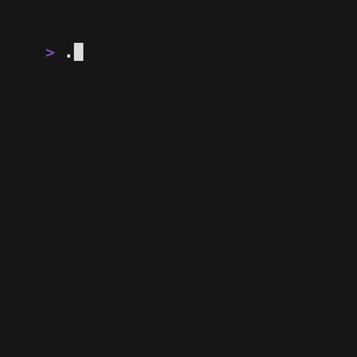

# barkeep



barkeep is the status bar i use to let me know what's going on with my mac. i
maintain [a million-line ray tracer](https://github.com/janearc/slayer/) so i
do a lot of overnight renders, and i have these test suites that sometimes
take thirty minutes or longer. i have to have an eye on what the computer is
doing kind of at all times.

you remember those touch bar macs that everyone hated? well, not me. i loved
that machine. i had all kinds of useful stuff displayed to my touchbar (i
actually never used it for *touch*, i just used it as an ambient display),
and this is exactly the kind of thing i used it for.

so given apple is not going to make a touchbar mac *just for me,* i figured
the next best thing to do is to build my own thing. i was using tmux and the
native status bar in tmux, and
[libtheme](https://github.com/janearc/libtheme-css) and was just doing this
little ramp/gradient thing, but then i got greedy and decided it needed to
have a lava lamp. and then once that happens you have to add dogs, right? you
have to add dogs. so there's dogs.

this is an unserious project, i am maintaining it for myself. i don't know if
it will work for you. if you want me to change it, i will probably do that,
but i can't guarantee i am even still using it.

i use [charm tone](https://github.com/charmbracelet/tone) for colorways
because charm makes great software and they're good people, and i use
[libreadme](https://github.com/janearc/libreadme) to manage the contrast to
keep it within a wcag calibrated contrast range for myself.

i stole the green scrambly thing from the wachowskis, but i'm sure they won't
mind.

# installation

my, aren't we brave?

```sh
go install github.com/janearc/barkeep/cmd/barkeep@latest
```

barkeep works like any other [`pzm`](https://github.com/janearc/puzzlemouth)
tool. it just kind of does what you expect right out of the box.

# author

i'm jane michelle arc and i'm `jmich@fastmail.nl`. i am not a potato.
